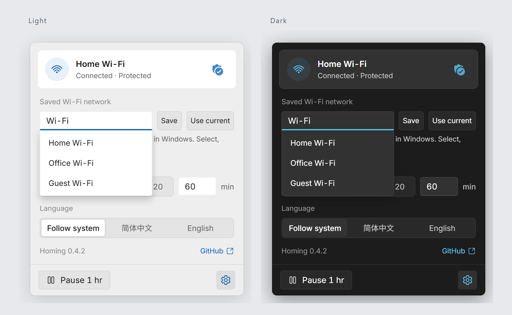

<div align="center">
  <h1>📶 Homing</h1>
  <p>A quiet way back to your Wi-Fi.</p>
  <p><a href="https://github.com/Hezric/Homing/actions/workflows/ci.yml"></a> <a href="https://github.com/Hezric/ScoopZephyr#install"></a> <a href="https://github.com/Hezric/Homing/blob/main/LICENSE"></a></p>
  <p>English | <a href="README_zh-Hans.md">简体中文</a></p>
</div>

<p align="center"><br><sub>Browser preview with simulated networks. Windows uses its native material.</sub></p>


Homing keeps a saved Windows Wi-Fi network within reach. When the target is absent, it asks Windows to reconnect; a small tray flyout shows the connection and lets you pause.

## Install

On Windows 11 with WebView2, install from [ScoopZephyr](https://github.com/Hezric/ScoopZephyr):

```powershell
scoop bucket add zephyr https://github.com/Hezric/ScoopZephyr
scoop install zephyr/homing
```

Or download the Windows x64 archive from [Releases](https://github.com/Hezric/Homing/releases/latest), verify `SHA256SUMS`, and extract it. Launching with an existing target or saving a target enables reconnect. Manage login startup separately; with Scoop, point it at the `current` executable.

## Use with an agent

```text
Install Homing from https://github.com/Hezric/Homing/releases/latest.
Verify the Windows x64 archive against SHA256SUMS, extract it, and check
homing.exe exists and read (Get-Item <path-to-homing.exe>).VersionInfo.FileVersion
without launching. Preserve settings and startup registration.
An existing or newly saved target enables Wi-Fi reconnect; ask before activation.
Install the homing Skill separately through my existing Skill manager. If I have
none, ask first and recommend npx skills add Hezric/Homing -g (Vercel skills CLI,
https://github.com/vercel-labs/skills; Node.js 22.20+). Verify its path and contents.
```

## Use

Click the tray icon, open settings and choose a network already saved in Windows. **Use current** fills the draft; **Save** applies it and enables reconnect. Matching is a case-sensitive substring of observed network names; `Home` also matches `MyHome5G`. If Windows turns off the software Wi-Fi radio, Homing tries to enable it before reconnecting. Hardware switches and global airplane mode remain under your control. Homing does not scan for networks or request passwords. Pause stops reconnect requests; restarting resumes them. Settings default to `%APPDATA%\Homing\Homing.toml`.

Scoop enables portable data automatically. Outside Scoop, stop the app and create an empty `portable` file beside the executable; settings then use `data/Homing.toml`. See the behavior guide below before migrating existing settings.

[Usage and behavior](https://github.com/Hezric/Homing/blob/main/docs/features/wifi-reconnect.md) · [Contribute and automated tests](https://github.com/Hezric/Homing/blob/main/CONTRIBUTING.md) · [MIT license](https://github.com/Hezric/Homing/blob/main/LICENSE) · [Third-party notices](https://github.com/Hezric/Homing/blob/main/THIRD-PARTY-NOTICES.md)

The portable archive includes license notices in `licenses/`.
