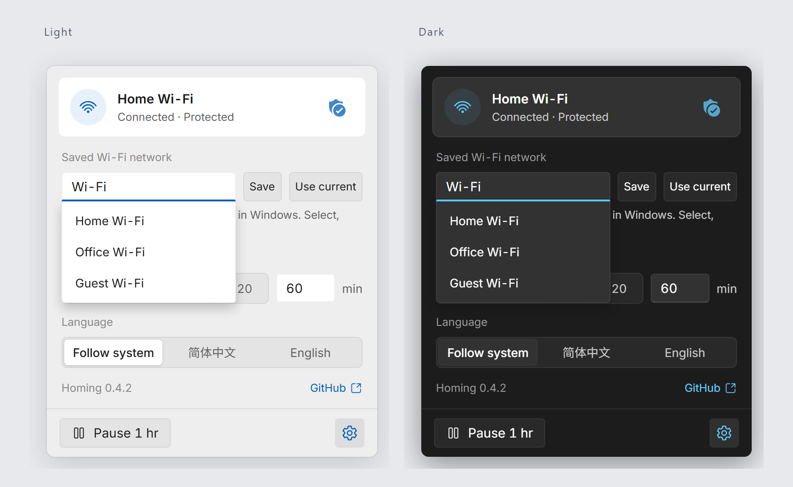

<div align="center">
  <h1>📶 Homing</h1>
  <p>让 Wi-Fi 静静归来。</p>
  <p><a href="https://github.com/Hezric/Homing/actions/workflows/ci.yml"></a> <a href="https://github.com/Hezric/ScoopZephyr#install"></a> <a href="https://github.com/Hezric/Homing/blob/main/LICENSE"></a></p>
  <p><a href="README.md">English</a> | 简体中文</p>
</div>

<p align="center"><br><sub>使用模拟网络的浏览器预览；Windows 中使用原生材质。</sub></p>


Homing 守候 Windows 中已保存的 Wi-Fi。目标网络不在时，它会请系统重新连接；小小的托盘面板可以查看连接状态，也可以暂停守护。

## 安装

在装有 WebView2 的 Windows 11 上，通过 [ScoopZephyr](https://github.com/Hezric/ScoopZephyr) 安装：

```powershell
scoop bucket add zephyr https://github.com/Hezric/ScoopZephyr
scoop install zephyr/homing
```

也可从[发布页](https://github.com/Hezric/Homing/releases/latest)下载 Windows x64 便携包，对照 `SHA256SUMS` 校验后解压。已有目标时启动或保存目标都会启用重连。登录启动请另行管理；使用 Scoop 时指向 `current` 目录下的程序。

## 交给智能体

```text
从 https://github.com/Hezric/Homing/releases/latest 安装 Homing。
对照 SHA256SUMS 校验 Windows x64 便携包，解压并确认 homing.exe 存在；不要启动，
用 (Get-Item <homing.exe 路径>).VersionInfo.FileVersion 读取文件版本。
保留已有设置和登录启动登记。已有目标或新保存目标会启用 Wi-Fi 重连，激活前先取得授权。
通过我已有的 Skill 管理方式单独安装 homing Skill。若没有，请先询问，建议使用
npx skills add Hezric/Homing -g（Vercel skills CLI，https://github.com/vercel-labs/skills；
要求 Node.js 22.20 及以上）。确认安装位置和完整内容。
```

## 使用

单击托盘图标，打开设置，选择 Windows 已保存的网络。**使用当前**只填入草稿，点击**保存**才生效并启用重连。匹配已观测网络名称时区分大小写，按子串匹配：`Home` 也会匹配 `MyHome5G`。Windows 的软件 Wi-Fi 开关关闭时，Homing 会尝试先开启再重连。硬件开关与全局飞行模式仍由你控制。Homing 不扫描网络，也不索要密码。暂停会停止重连请求，重启后恢复。设置默认保存在 `%APPDATA%\Homing\Homing.toml`。

Scoop 会自动启用便携数据。手动使用时，先停止程序，在 exe 旁建立空文件 `portable`，设置便会改用旁边的 `data/Homing.toml`。迁移现有设置前请阅读下方行为说明。

[使用与行为](https://github.com/Hezric/Homing/blob/main/docs/features/wifi-reconnect.md) · [参与贡献与自动化测试](https://github.com/Hezric/Homing/blob/main/CONTRIBUTING.md) · [MIT 许可](https://github.com/Hezric/Homing/blob/main/LICENSE) · [第三方声明](https://github.com/Hezric/Homing/blob/main/THIRD-PARTY-NOTICES.md)

便携包的 `licenses/` 中附有许可声明。
